# [bundlejs](https://bundlejs.com)

bundlejs lets you write imports in a browser editor, build them, and inspect the
bundled and compressed output size. Use it to compare the code included by a
particular import, or to share a small bundle example with another developer.

The browser app fetches package files and performs its build in a worker. The
separate [bundlejs API](https://deno.bundlejs.com) provides server-side builds and
size badges. A result describes the selected code and build settings; it does not
predict the size or performance of an entire application.

## Check a bundle

1. Open [bundlejs.com](https://bundlejs.com).
2. Search for a package or write the imports and exports in the input editor.
3. Choose **Build** after the editor and bundler are ready.
4. Read the output and size result. Use the console to investigate build errors.
5. Adjust the imports or settings and build again to compare the result.

Bundling still needs access to the package sources. A package that depends on
unsupported runtime features or unavailable files may fail to build. Keep the
input and relevant console error when reporting a problem.

## Share code and settings

Choose **Share** to create a URL from the current editor content and configuration.
When the browser supports the Web Share API, the button opens the system share
interface. Otherwise, it attempts to copy the URL to the clipboard. Reopen the
link and compare the input and settings before using it as a reproduction.

You can also construct a package query, for example
[`?q=react,react-dom`](https://bundlejs.com/?q=react,react-dom).
The query selects modules; the editor shows the code that the app will build.

| Parameter | Purpose |
| --- | --- |
| `q` or `query` | Comma-separated module specifiers. `query` takes priority when both are set. |
| `treeshake` | Export or import clauses, grouped in square brackets in the same order as the modules. |
| `share` | Compressed source that the parser appends after generated module statements. |
| `text` | Plain source that the parser appends after any `share` content. |
| `config` | JSON configuration merged with the app's default settings. |
| `bundle` | Start a build after initialization. |
| `analysis` or `analyze` | Request bundle-analysis data. |

The URL generator separates leading import/export statements from the remaining
source. It stores module statements in `q` and `treeshake`, then uses `share` or
`text` for the rest. It also includes configuration that differs from the defaults.
This is why a generated URL can use several parameters instead of one encoded
copy of the editor.

For example, [`?q=react&bundle`](https://bundlejs.com/?q=react&bundle) opens a React
query and requests an automatic build. Use the generated Share link for an example
with custom source and settings.

## Add a badge

These badges link to the browser app:

[](https://bundlejs.com/)
[](https://bundlejs.com/)

```md
[](https://bundlejs.com/)
[](https://bundlejs.com/)
```

A size badge uses the API. This example measures `spring-easing` and links to its
browser query:

```md
[](https://bundlejs.com/?q=spring-easing)
```

## Follow a build through the source

| Stage | Responsible source | Result |
| --- | --- | --- |
| Read the URL | [`parse-query.ts`](src/ts/util/parse-query.ts) | Input source and configuration for the editor |
| Create editor models | [`monaco.ts`](src/ts/modules/monaco.ts) | Input, output, and settings models |
| Start a build | [`index.ts`](src/ts/index.ts) | A `bundle` event and message to the bundling worker |
| Bundle and report | [`esbuild.ts`](src/ts/workers/esbuild.ts) | Worker messages for results, analysis, and logs |
| Display the result | [`index.ts`](src/ts/index.ts) | Output code, size, and console updates |
| Create a share URL | [`ts-worker-factory.ts`](src/ts/workers/ts-worker-factory.ts) | Module clauses, remaining source, and changed settings encoded in a URL |

`BundleEvents` connects UI actions with worker messages. A successful build emits
`result`; errors use the error/log path. When changing build controls, check both
paths so the user can recover after a failed build.

The editor uses Monaco, the bundler uses esbuild, and the bundle visualizations
use esbuild-visualizer code and D3. Pug templates and SCSS provide the surrounding
interface. [`gulpfile.js`](gulpfile.js) defines the build and preview tasks.

## Work on the application

The repository uses pnpm. Install dependencies from the lockfile, then run the
build or preview script:

```sh
pnpm install --frozen-lockfile
pnpm build
pnpm preview
```

`pnpm test` currently runs the build. It is not a separate behavior test suite.
For a sharing change, also compare the original and reopened source, configuration,
and output. Include import/export combinations and a failed build in that review.

Open issues and pull requests at [okikio/bundlejs](https://github.com/okikio/bundlejs).
The repository uses Conventional Commits; `pnpm commit` opens its Commitizen flow.

## Related projects and documentation

The project draws on [neo-tools](https://github.com/hardfist/neo-tools),
[uniroll](https://github.com/mizchi/uniroll),
[play-esbuild](https://github.com/egoist/play-esbuild), and
[esbuild-repl](https://github.com/hyrious/esbuild-repl).
[DeepWiki](https://deepwiki.com/okikio/bundlejs/) has additional generated background;
check the current source when a detail differs.

## Backers & Sponsors

Backers & Sponsors are awesome people and organizations who use, enjoy, and donate to the project. The list of backers who love and support this project are,

<!---
<a href="https://opencollective.com/bundle"></a>
<a href="https://opencollective.com/bundle"></a>
<object type="image/svg+xml" data="https://opencollective.com/collective/tiers/backers.svg?avatarHeight=36&width=600"></object>
-->

<a href="https://upstash.com?utm_source=github&utm_medium=github&utm_campaign=bundlejs">
  
</a>

<a href="https://vercel.com?utm_source=github&utm_medium=github&utm_campaign=bundlejs">
  
</a>

<a href="https://sheetjs.com/?utm_source=opencollective&utm_medium=github&utm_campaign=bundle"></a>
<a href="https://opencollective.com/bundle/individuals/0/website"></a>
<a href="https://opencollective.com/bundle/organization/1/website"></a>
